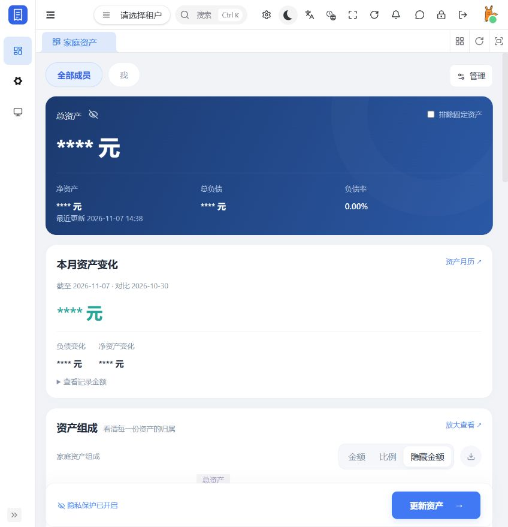
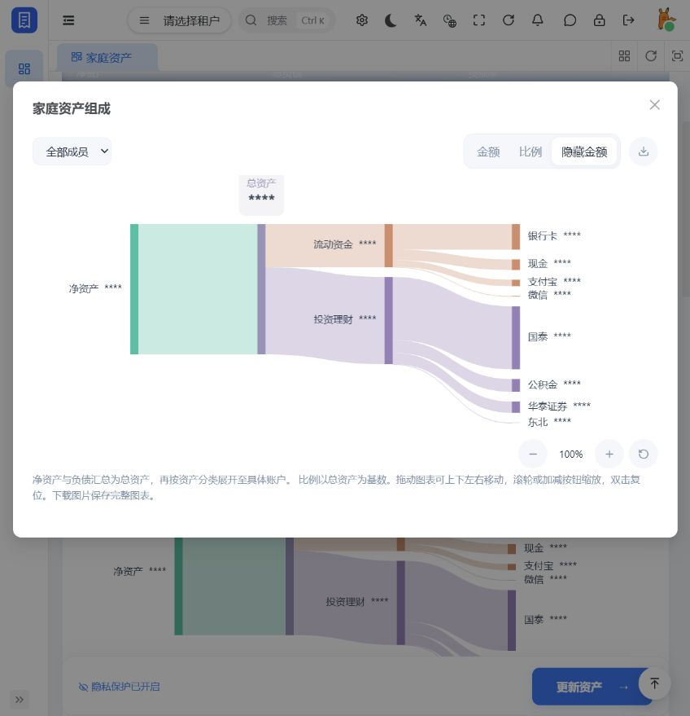
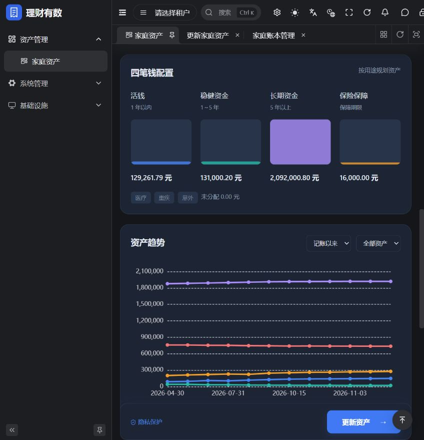
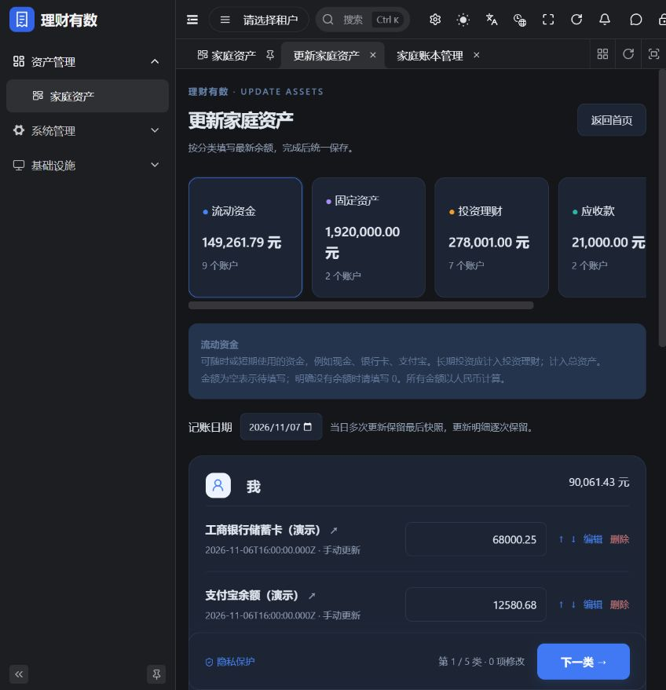

# 理财有数 · Financial

家庭资产记账系统：把家庭成员的资产、负债和长期变化放在同一本账里。后端采用 JDK 25 + Spring Boot 4，前端采用 Vue 3 + Vben 5 + Ant Design Vue。

[前端仓库](https://github.com/MonochromeCode/financial-ui) · [业务模块说明](financial-server/README.md) · [资产接口与规则](financial-server/docs/assets.md)

## 页面预览

以下为 2026-11-07 本地运行的最新页面，截图已开启金额隐私保护。

### 家庭资产首页



<details>
<summary>查看可拖动、缩放的资产组成桑基图</summary>



</details>

<details>
<summary>查看四笔钱配置与资产趋势</summary>



</details>

<details>
<summary>查看资产更新页面</summary>



</details>

## 已实现功能

- 家庭总览：总资产、净资产、总负债、负债率，以及月度资产变化。
- 历史金额明细：“查看记录金额”弹窗按全部历史记账日期展示，以银行卡、现金、支付宝等账户为列，并列出总资产、总负债、净资产；同日取最后余额，未修改账户沿用上次余额，遵循成员及固定资产筛选。
- 资产组成桑基图：净资产/总负债 → 总资产 → 资产分类 → 具体账户，支持金额/比例切换、隐藏金额、成员筛选、整图平移缩放、放大查看和完整图表 PNG 下载。
- 五类账户：流动资金、固定资产、投资理财、应收款、负债。
- 四笔钱配置：活钱、稳健资金、长期资金、保险保障。
- 家庭协作：成员管理、成员筛选、家庭范围隔离及查看权限控制。
- 资产更新：按分类编辑余额、账户排序、空余额与零余额区分、草稿恢复。
- 历史追踪：逐账户更新记录、每日快照、趋势图和资产月历。
- Excel 导出：下载资产汇总、与“查看记录金额”一致的账户明细和全部历史账户变动，包含已删除账户的历史，按登录用户的可见成员范围校验，支持成员、排除固定资产和金额隐藏状态。
- 金额保护：BigDecimal / DECIMAL 存储、事务提交、并发版本校验、请求去重。
- 页面适配：紧凑首页工具栏、桌面与移动端 H5 布局、深浅主题、金额隐私开关。

当前版本记录家庭资产负债表，尚未提供日常消费流水、银行账户自动同步或原生 App。

桑基图支持鼠标左键或单指拖动平移、滚轮以鼠标位置为中心缩放，以及加减按钮缩放（50%～300%）；双击或点击复位恢复初始视图。聚焦图表后可用方向键平移、`+` / `-` 缩放、`0` / `Home` 复位。首页和放大弹窗均支持这些操作，图片下载保存完整图表。

月度变化按最近快照与该快照所在月份之前的最后一次快照比较；没有基准时标记首次记录，没有快照时显示暂无资产记录。`GET /admin-api/finance/assets/dashboard` 同时返回当前用户可见范围的 `accounts` 明细，供桑基图展开真实账户。总览、月度金额及图表均遵循成员、固定资产和金额隐私筛选。

## 技术与结构

| 部分 | 技术 |
| --- | --- |
| 运行环境 | JDK 25、Maven 3.9+ |
| 后端框架 | Spring Boot 4.1.2、Spring Security |
| 数据存储 | MySQL 8、Redis、MyBatis Plus / Mapper XML |
| 前端 | Vue 3、TypeScript、Vben 5、Ant Design Vue、ECharts |

```text
financial/
├── financial-dependencies/       依赖版本管理
├── financial-framework/          公共组件与 Spring Boot starters
├── financial-module-system/      用户、角色、权限、租户等系统能力
├── financial-module-infra/       基础设施能力
├── financial-module-assets/      家庭资产、业务校验、金额计算、导出
│   ├── src/main/java/cn/iocoder/financial/module/assets/
│   │   ├── controller/admin/assets/vo/ 独立请求与响应 VO
│   │   ├── service/assets/       Service 接口、实现及业务辅助类
│   │   ├── convert/assets/       业务结果与响应 VO 转换
│   │   ├── enums/                固定计算口径与字典类型
│   │   └── dal/assets/           租户参数封装与 Mapper 接口
│   └── src/main/resources/mapper/assets/AssetMapper.xml
├── financial-server/             启动入口、配置与模块装配
├── script/sql/household-assets.sql
└── script/seed-household-demo.ps1
```

`financial-server` 负责启动和模块装配，资产业务独立为 `financial-module-assets`。资产代码按 system 模块的领域子包组织：Controller 只负责参数校验和响应，Service 使用接口与 `ServiceImpl` 分离，VO 独立成文件，复杂结果经 convert 转换；SQL 集中在 Mapper XML，所有资产读写显式绑定当前租户和家庭范围。金额汇总与月度比较由 `AssetAmounts` 处理，历史状态还原由 `AssetAccountSnapshots` 处理。

账户模板、资金用途、保险类型、操作类型、来源及新账本的分类名称统一使用系统字典；前端通过 `/finance/assets/context` 的 `options` 读取，与后端校验、Excel 导出共享配置。已有家庭分类仍在家庭设置中单独维护。

## 本地启动

### 1. 获取代码

```shell
git clone https://github.com/MonochromeCode/financial.git
git clone https://github.com/MonochromeCode/financial-ui.git
cd financial
```

### 2. 初始化 MySQL

准备 MySQL 8 和 Redis。在后端项目根目录执行 `mysql -u root -p`，进入 MySQL 客户端后执行：

```sql
CREATE DATABASE financial CHARACTER SET utf8mb4 COLLATE utf8mb4_unicode_ci;
USE financial;
SOURCE sql/mysql/ruoyi-vue-pro.sql;
SOURCE script/sql/household-assets.sql;
SOURCE script/sql/household-assets-dictionaries.sql;
```

基础 SQL 含建表和初始化数据，**仅在新建空数据库中执行**。家庭资产 SQL 创建七张 `financial_*` 表，可重复执行。已有库升级时执行 `script/sql/household-assets-dictionaries.sql` 补齐资产字典，不覆盖已有字典配置和家庭数据。

### 3. 配置并启动后端

默认启用 `local` profile。通过环境变量覆盖数据库和 Redis 配置，以下为 PowerShell 7 示例：

```powershell
$env:SPRING_DATASOURCE_DYNAMIC_DATASOURCE_MASTER_URL = 'jdbc:mysql://127.0.0.1:3306/financial?useSSL=false&serverTimezone=Asia/Shanghai&allowPublicKeyRetrieval=true&nullCatalogMeansCurrent=true&rewriteBatchedStatements=true'
$env:SPRING_DATASOURCE_DYNAMIC_DATASOURCE_MASTER_USERNAME = 'root'
$env:SPRING_DATASOURCE_DYNAMIC_DATASOURCE_MASTER_PASSWORD = Read-Host 'MySQL 密码' -MaskInput
$env:SPRING_DATASOURCE_DYNAMIC_DATASOURCE_SLAVE_URL = $env:SPRING_DATASOURCE_DYNAMIC_DATASOURCE_MASTER_URL
$env:SPRING_DATASOURCE_DYNAMIC_DATASOURCE_SLAVE_USERNAME = $env:SPRING_DATASOURCE_DYNAMIC_DATASOURCE_MASTER_USERNAME
$env:SPRING_DATASOURCE_DYNAMIC_DATASOURCE_SLAVE_PASSWORD = $env:SPRING_DATASOURCE_DYNAMIC_DATASOURCE_MASTER_PASSWORD
$env:SPRING_DATA_REDIS_HOST = '127.0.0.1'
$env:SPRING_DATA_REDIS_PORT = '6379'
$env:SPRING_DATA_REDIS_DATABASE = '1'
mvn -pl financial-server -am clean verify
java -jar financial-server/target/financial-server.jar
```

若 Redis 启用了认证，另设置 `SPRING_DATA_REDIS_PASSWORD`。后端默认端口 `48080`，管理端接口前缀 `/admin-api`。

### 4. 启动前端

使用 Node.js 24.12+（24.x）和 pnpm 11.16.0，进入前端仓库：

```shell
pnpm install
pnpm --filter @vben/web-antd exec vite --mode development --port 5173
```

浏览器访问 <http://localhost:5173>。默认初始化账号为 `admin` / `admin123`，登录后进入“资产管理 → 家庭资产”，首次使用建立家庭账本。部署到共享环境前更换默认登录密码及示例密钥。

## 演示数据

先创建一个空家庭账本，再在后端工程根目录使用 PowerShell 7 执行：

```powershell
$env:FINANCIAL_DEMO_PASSWORD = Read-Host '账本所有者登录密码' -MaskInput
./script/seed-household-demo.ps1 -Username admin
Remove-Item Env:FINANCIAL_DEMO_PASSWORD
```

脚本生成 3 位成员、23 个账户、12 天快照和 276 条更新记录；有现存资产或历史时会停止。演示日期为 2026-04-30 至 2026-11-07，运行日期须不早于 2026-11-07。

演示汇总：总资产 **2,368,262.79 元**，总负债 **736,860.35 元**，净资产 **1,631,402.44 元**。保险类演示金额为准备金或保单现金价值。

## 许可与来源

基于 [yudao-boot-mini](https://github.com/yudaocode/yudao-boot-mini) 的 JDK 25 版本开发，前端基于 [yudao-ui-admin-vben](https://github.com/yudaocode/yudao-ui-admin-vben) 与 [Vue Vben Admin](https://github.com/vbenjs/vue-vben-admin)。遵循 [MIT License](LICENSE)，保留上游版权声明。
